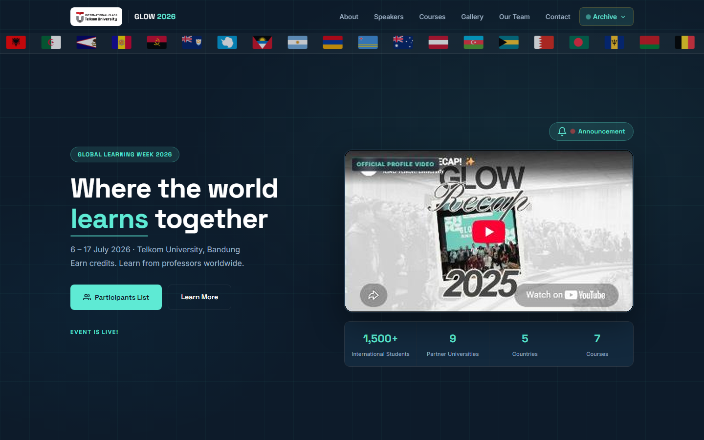
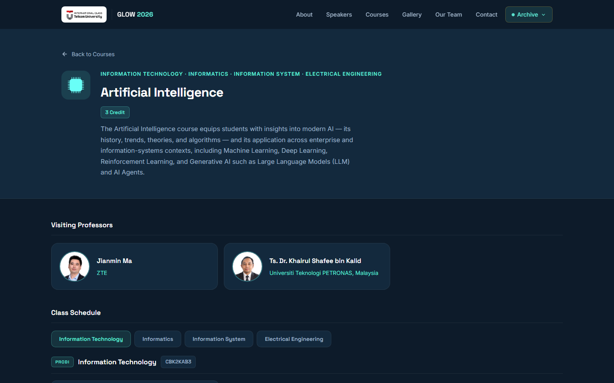
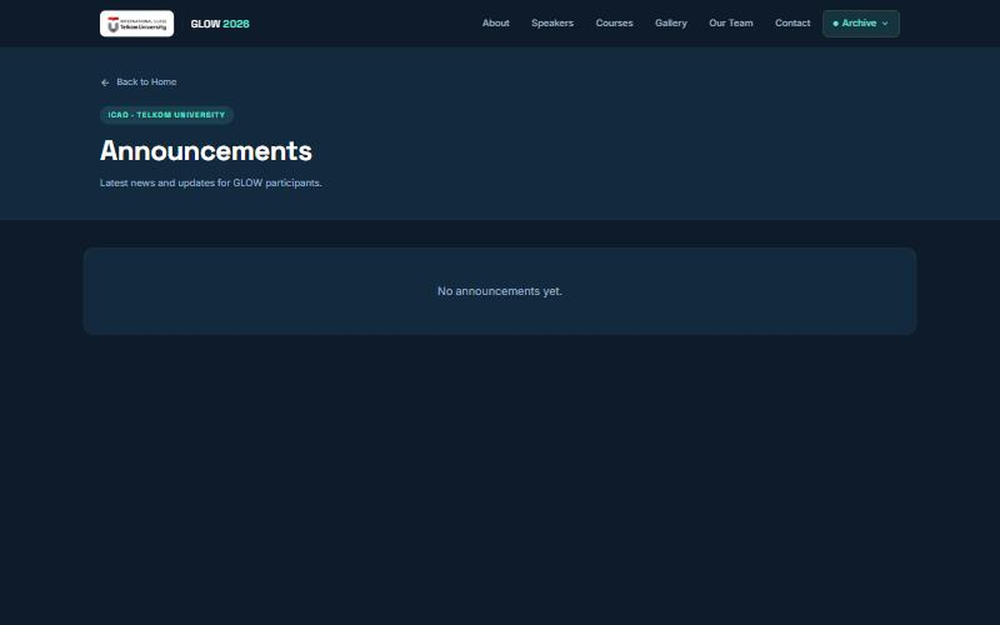
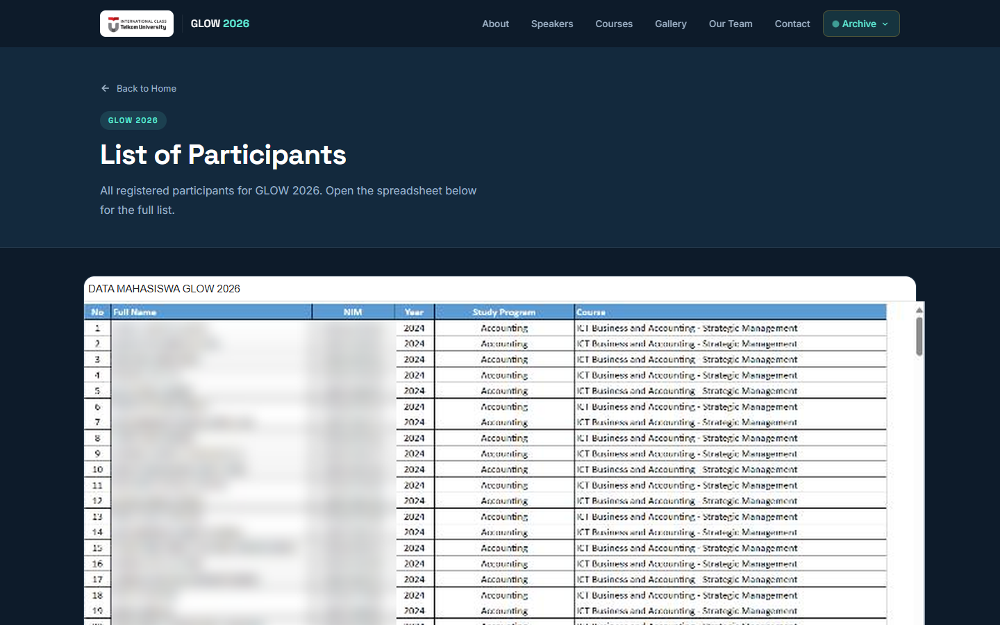

# GLOW 2026 : Global Learning Week

Official event website for **GLOW 2026 (Global Learning Week)**, a two-week, credit-earning international academic program held at Telkom University, Bandung (6–17 July 2026). Visiting professors from partner universities teach alongside Telkom University co-lecturers, and students earn 2–4 academic credits.

The site gives participants one place to find the program overview, speakers, course schedules and rooms, announcements, and the participant list. Committee admins publish announcements through a login-protected panel backed by Firebase.



## Features

- **Landing page:** hero with a live countdown, profile video, program stats, partner universities, speaker profiles, embedded program book, photo gallery with lightbox, team, contact form and partner logos.
- **Course detail pages** (`/course/:slug`): description, credit weight, visiting professors, and a per-study-program schedule (Week 1 and Week 2) with date, time, lecturer and room. The full schedule spreadsheet opens in a modal.
- **Announcements** (`/pengumuman`): public list of announcements read from Cloud Firestore.
- **Admin panel** (`/announce`, not linked publicly): Firebase Authentication login; create, edit and delete announcements.
- **Participant list** (`/participants`): embedded published spreadsheet of registered participants.
- **Contact form:** messages are delivered by EmailJS, so no backend server is needed.
- Responsive layout, SEO and Open Graph meta tags, lazy-loaded images, and redirects for old routes.

## Screenshots

| Home | Course detail |
|---|---|
|  |  |
| **Announcements** | **Participants** |
|  |  |

<sub>Participant names and student IDs are blurred in the screenshot.</sub>

## Tech stack

| Area | Tools |
|---|---|
| UI | React 19, React Router 7, plain CSS per component |
| Animation | Framer Motion |
| Backend services | Firebase Authentication, Cloud Firestore |
| Email | EmailJS (`@emailjs/browser`) |
| Data helpers | `country-list` (flag marquee) |
| Tooling | Create React App (`react-scripts` 5) |
| Fonts | Space Grotesk, Inter (Google Fonts) |

## Getting started

Requirements: Node.js 18 or newer and npm.

```bash
git clone https://github.com/<antarezQ>/glow2026.git
cd glow2026
npm install
```

### Environment variables

Copy the example file and fill in the values from the Firebase Console (Project settings → Your apps) and the EmailJS dashboard:

```bash
cp .env.example .env
```

| Variable | Purpose |
|---|---|
| `REACT_APP_FIREBASE_API_KEY`, `..._AUTH_DOMAIN`, `..._PROJECT_ID`, `..._STORAGE_BUCKET`, `..._MESSAGING_SENDER_ID`, `..._APP_ID`, `..._MEASUREMENT_ID` | Firebase web app config |
| `REACT_APP_EMAILJS_SERVICE_ID`, `..._TEMPLATE_ID`, `..._PUBLIC_KEY` | EmailJS contact form |

`.env` is git-ignored. Create React App inlines `REACT_APP_*` values at build time, so restart `npm start` after changing them. These are client-side keys, so protect your data with Firestore security rules (for example, only authenticated admins may write to `pengumuman`).

### Run locally

```bash
npm start
```

The app opens at http://localhost:3000.

### Production build

```bash
npm run build
```

The optimized static site is written to `build/`.

## Deployment

The output is a static single-page app, so it works on any static host. The live site runs on Hostinger shared hosting:

1. Run `npm run build` with the production `.env` in place.
2. Upload the **contents** of `build/` to `public_html` (File Manager or FTP).
3. Add this `.htaccess` to `public_html` so React Router routes such as `/course/...` don't return 404 on refresh:

```apache
<IfModule mod_rewrite.c>
  RewriteEngine On
  RewriteBase /
  RewriteRule ^index\.html$ - [L]
  RewriteCond %{REQUEST_FILENAME} !-f
  RewriteCond %{REQUEST_FILENAME} !-d
  RewriteRule . /index.html [L]
</IfModule>
```

On Netlify or Vercel, set the build command to `npm run build`, set the output directory to `build`, add the environment variables in the dashboard, and add a rewrite from `/*` to `/index.html`.

## Project structure

```
glow2026/
├── public/
│   ├── index.html            # HTML shell, SEO + Open Graph tags
│   └── img/                  # speakers, partners, gallery, course icons
├── src/
│   ├── index.js              # React entry point
│   ├── App.jsx               # routes + scroll-to-hash handling
│   ├── firebase.js           # Firebase init (reads .env)
│   ├── index.css             # global styles and design tokens
│   ├── components/           # landing-page sections
│   │   ├── Navbar, Hero, About, ProgramBook, Speakers,
│   │   ├── Courses (course list, also source of the course count),
│   │   └── Gallery, Team, Contact, PartnersLogos, Footer
│   └── pages/
│       ├── CourseDetail.jsx  # course data, schedules and rooms
│       ├── Pengumuman.jsx    # public announcements
│       ├── AdminAnnounce.jsx # admin login + announcement CRUD
│       └── Participants.jsx  # participant list
├── docs/screenshots/         # images used in this README
├── .env.example
└── package.json
```

## Routes

| Route | Page |
|---|---|
| `/` | Landing page |
| `/course/:slug` | Course detail and schedule |
| `/pengumuman` | Announcements |
| `/participants` | Participant list |
| `/announce` | Admin panel (`/login` and `/admin` redirect here) |

## Credits

Built for the International Class & Academic Office (ICAO), Telkom University. Logos, photos and course content belong to Telkom University and the partner institutions.
